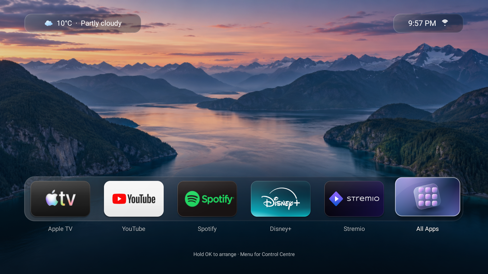
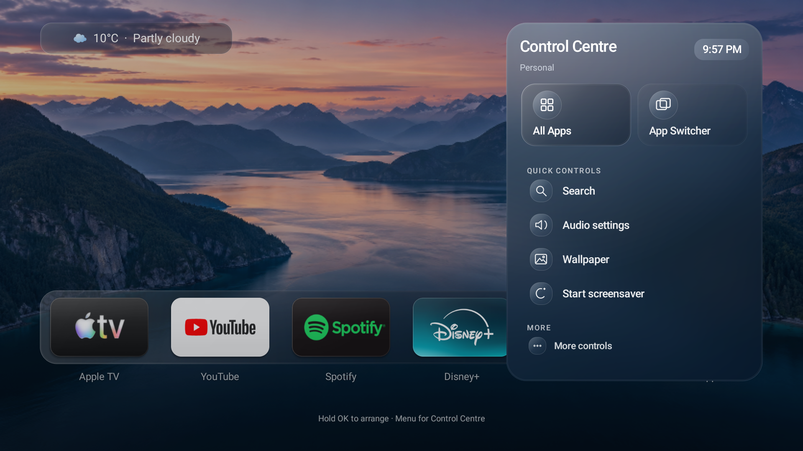
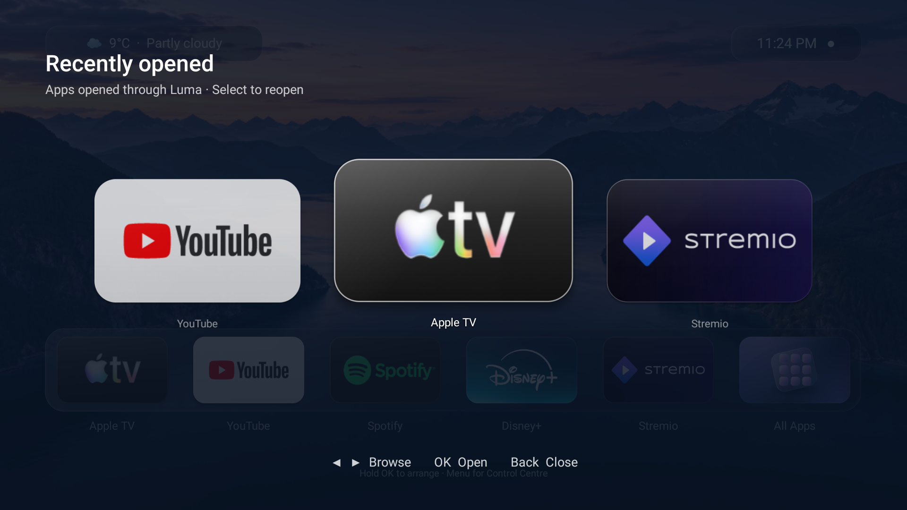
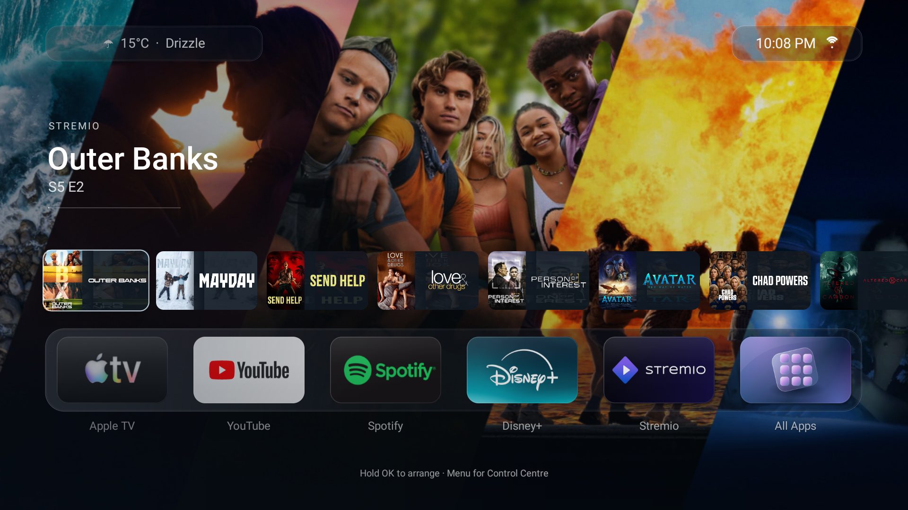

# Luma Launcher

**A cinematic, remote-first home screen for Android TV.** Luma brings together a refined app dock, glass-inspired controls, an App Switcher, live weather, and Continue Watching when real viewing data is available.

[**Download the signed v1.0.0 APK**](https://github.com/smzaki101-lab/luma-launcher/releases/download/v1.0.0/Luma-v1.0.0-signed.apk) · [Release notes](https://github.com/smzaki101-lab/luma-launcher/releases/tag/v1.0.0) · [Install & recovery](docs/INSTALL.md)



## Explore Luma

| Control Centre | App Switcher |
| :--- | :--- |
|  |  |
| A calm, remote-friendly panel for quick actions. An optional shortcut can open it over other apps on compatible TVs. | Move between recently used apps without searching through the full library. |

| Continue Watching |
| :--- |
|  |
| Browse genuine titles from supported Android TV Watch Next entries and Stremio data. Manual entries and optional Trakt support provide additional choices; progress is shown only when a source supplies it. |

Screenshots show one tested setup. Installed apps, content, wallpaper, weather and remote behavior vary by device. The App Switcher screenshot is from an earlier beta. Third-party names, logos and title artwork belong to their owners.

## Highlights

- **Made for a remote:** D-pad navigation, animated focus, an editable dock, All Apps and app launching.
- **Personal home screen:** custom tile identities, wallpapers, live weather with offline cache, clock and screensaver.
- **Quick access:** Control Centre and App Switcher. The optional [global Menu shortcut](docs/GLOBAL-MENU.md) depends on the TV's remote mapping and Accessibility support.
- **Real Continue Watching:** Android TV Watch Next and supported Stremio entries, with provider links where available. Luma never invents playback history or progress.
- **Easy recovery:** Luma does not remove your existing launcher. Android's Home App chooser and [ADB uninstall steps](docs/INSTALL.md) remain available.

## Install

Download [Luma-v1.0.0-signed.apk](https://github.com/smzaki101-lab/luma-launcher/releases/download/v1.0.0/Luma-v1.0.0-signed.apk), then install it with an Android TV installer or ADB. Open it from your existing app list before choosing any default Home app. See the [installation guide](docs/INSTALL.md) for the upgrade note, setup and uninstall command.

The application ID is `dev.luma.launcher`. Device compatibility beyond the original test hardware is still being established; see [known limitations](docs/KNOWN-LIMITATIONS.md). The P6-specific [Mac-assisted Menu bridge](docs/P6-MENU-BRIDGE.md) is optional and is not needed for normal Luma operation.

## Build from source

Install JDK 17 and Android SDK 35, then run:

```sh
./gradlew :app:assembleDebug :app:testDebugUnitTest :app:lintDebug
```

The project uses Gradle 8.9 and can also be opened in Android Studio. Production signing uses local `LUMA_RELEASE_*` environment variables; the private key is not in this repository. See [release preparation](docs/RELEASE-PREPARATION.md), [privacy](docs/PRIVACY.md) and [asset attribution](docs/ASSETS.md).

Luma is published under the [Apache License 2.0](LICENSE). It is an independent project and is not affiliated with Apple, Google, Stremio or any streaming provider.
